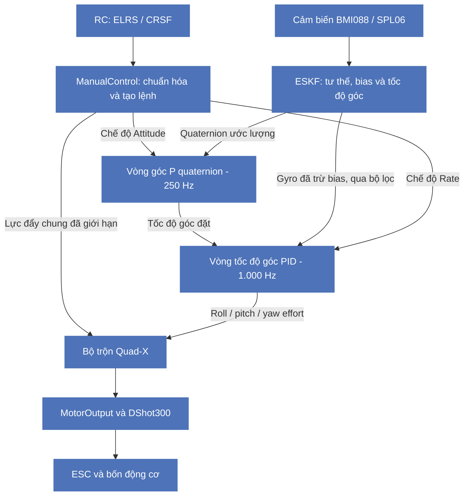

# MicoAir H743 V2 — Firmware điều khiển bay P/PID nối tầng

Firmware điều khiển bay tự phát triển cho **MicoAir H743 V2**, sử dụng vi điều khiển **STM32H743VIT6 Cortex-M7**, ngôn ngữ **C** và **FreeRTOS thông qua CMSIS-RTOS2**.

Dự án triển khai chuỗi xử lý từ giao tiếp cảm biến, thu thập dữ liệu bằng DMA, hiệu chuẩn, ước lượng trạng thái, tạo lệnh điều khiển đến phân bổ đầu ra và phát DShot300 cho bốn động cơ. STM32CubeMX/STM32CubeIDE được sử dụng để cấu hình và sinh mã khởi tạo; các module ứng dụng được tổ chức riêng để thuận tiện cho việc nghiên cứu, kiểm thử và mở rộng.

**Trạng thái:** Mã nguồn đang triển khai với vòng điều khiển tốc độ góc và tư thế; khi hoạt động vẫn còn đang bị trôi vì chưa có vòng điều khiển vị trí. Hướng phát triển tương lai tích hợp thêm GPS hoặc MTF01 để giữ vị trí và lơ lửng trên không đảm bảo tính ổn định và kháng nhiễu của thiết bị. 
**Repository:** [khoa-asta/MicoAir-H743v2-Firmware](https://github.com/khoa-asta/MicoAir-H743v2-Firmware).

## 1. Phạm vi dự án và các nội dung kỹ thuật chính

Đây là dự án firmware MCU độc lập trên STM32H743, sử dụng bộ điều khiển PID với cấu trúc phần tầng. Chuỗi điều khiển chính tập trung vào **tư thế/góc** và **tốc độ góc** của quadrotor. Tốc độ góc ở đây là p, q, r quanh các trục thân, đơn vị rad/s; chưa phải điều khiển vận tốc tịnh tiến hoặc vị trí trong không gian.

Vòng điều khiển sử dụng trong mã nguồn:

| Vòng điều khiển | Thuật toán thực tế | Đầu ra |
| --- | --- | --- |
| Góc / Attitude | P trên sai số quaternion | Tốc độ góc đặt `rate_sp[3]` |
| Tốc độ góc / Rate | Bộ điều khiển PID thông thường | Yêu cầu điều khiển roll/pitch/yaw cho tầng tiếp theo |


Các nội dung kỹ thuật chính:

- Khai thác STM32H743 với CPU 480 MHz, interrupt, timer và DMA.
- Viết driver BMI088, SPL06, QMC5883L, giao tiếp ELRS/CRSF và DShot300.
- Tổ chức thu thập dữ liệu theo sự kiện DRDY/DMA, sử dụng thread flags để đồng bộ ISR và task.
- Xử lý tính nhất quán dữ liệu giữa CPU, D-cache và DMA trên Cortex-M7.
- Hiệu chuẩn dữ liệu IMU và biến đổi về hệ trục thân FRD.
- Xây dựng thư viện quaternion và bộ lọc ESKF với không gian sai số 15 chiều.
- Tích hợp vòng góc P quaternion, vòng tốc độ góc PID, chống bão hòa tích phân và bộ trộn Quad-X.
- Kiểm tra điều kiện Arm, Kill, tuổi dữ liệu, trạng thái estimator và tiến độ truyền lệnh động cơ.
- Theo dõi heap, stack và các chỉ số thời gian phục vụ kiểm thử phần cứng.

## 2. Trạng thái triển khai

Bảng dưới đây mô tả  mã nguồn và cấu hình mặc định. Việc một module đã được triển khai không đồng nghĩa với việc đã hoàn thành kiểm thử bay.

| Thành phần | Đã có trong mã nguồn | Cấu hình và phần còn lại |
| --- | --- | --- |
| BMI088 | Driver thanh ghi, DRDY, hiệu chuẩn và IMUTask | IMU chính; gyro 1.000 Hz, accelerometer 800 Hz |
| SPL06 | Đọc và bù áp suất/nhiệt độ, đổi áp suất sang độ cao, BaroTask | Task đọc ở 50 Hz; estimator lấy áp suất lúc khởi động làm mốc độ cao |
| QMC5883L | Driver, đổi dữ liệu sang µT, CompassTask | Task đọc ở 50 Hz; chưa bật hợp nhất vào estimator do chưa xác nhận hiệu chuẩn và hướng trục |
| ELRS/CRSF | UART DMA, FIFO phần mềm, parser, kiểm tra CRC và giải mã 16 kênh | USART6 ở 420.000 baud; có kiểm tra tuổi frame và lỗi đường truyền |
| Estimator | Khởi tạo khi đứng yên, dự đoán bằng IMU, các phép cập nhật và cờ hợp lệ | Bước tích phân cố định 1 ms; chính sách hỗ trợ bằng trọng lực hiện dành cho thử trên bàn |
| Điều khiển góc/tốc độ góc | Xử lý RC, bộ lọc, vòng góc P quaternion, vòng tốc độ góc PID và bộ trộn Quad-X | Đã tích hợp vào luồng gọi; Arm cần xác nhận RC và hình học động cơ |
| Điều khiển độ cao | Nhánh điều khiển độ cao/tốc độ lên xuống | Tắt mặc định |
| Điều khiển vị trí | Có mã định danh chế độ và điều kiện chặn | Chưa triển khai; chọn chế độ này sẽ bị chặn |
| DShot300 | Phát bốn kênh bằng TIM1/DMA và giám sát đầu ra | Có phần phát theo định dạng hai chiều; chưa có thu/giải mã RPM |
| BMI270 | Cấu hình SPI3, GPIO và DMA | Chưa có driver thiết bị và hợp nhất IMU dự phòng |
| GPS, optical flow, telemetry | Cấu hình USART3, UART4 và USART1 | Chưa tích hợp xử lý dữ liệu/giao thức ở tầng ứng dụng |
| Thẻ nhớ | Cấu hình, khởi tạo SDMMC1 và các file FatFS | Chưa có task ghi log ứng dụng |

## 3. Sơ đồ điều khiển

Sơ đồ khối của hệ thống



- **Attitude mode:** RC tạo roll/pitch đặt và lệnh tốc độ yaw; vòng góc tạo tốc độ góc đặt cho vòng PID bên trong.
- **Rate mode:** RC tạo trực tiếp tốc độ góc đặt, bỏ qua vòng góc.
- **Throttle:** trong hai chế độ trên, được đổi thành lực đẩy chung và giới hạn tốc độ thay đổi trước khi trộn với yêu cầu roll/pitch/yaw.
- **Arm/Kill và tính hợp lệ:** được kiểm tra bởi `FlightControl_Poll()` để cho phép hoặc dừng đầu ra, không phải một task điều khiển riêng.


### 3.1 Đối chiếu từng khối với code

| Khối | File và hàm chính | Vai trò |
| --- | --- | --- |
| Thu thập IMU | [imu_task.c](RTOS/Src/imu_task.c): `IMUTask_Run()` | Nhận DRDY/DMA, chuyển đổi, hiệu chuẩn và công bố mẫu |
| Estimator | [estimator_port.c](Estimator/Src/estimator_port.c), [estimator.c](Estimator/Src/estimator.c) | Dự đoán/cập nhật trạng thái; trả quaternion và gyro đã trừ bias |
| Nhận RC | [rc_task.c](RTOS/Src/rc_task.c): `RCTask_Run()` | Đọc FIFO, parser CRSF, công bố kênh và trạng thái liên kết |
| Lệnh điều khiển tay | [manual_control.c](Flight/Src/manual_control.c): `ManualControl_Read()` | Ánh xạ kênh, vùng chết, expo, throttle và công tắc |
| Vòng góc | [attitude_control.c](Control/Src/attitude_control.c): `AttitudeControl_Update()` | Sai số quaternion và hệ số P tạo tốc độ góc đặt |
| Vòng tốc độ góc | [flight_control.c](Flight/Src/flight_control.c): `UpdateRateControl()`; [control_pid.c](Control/Src/control_pid.c) | Ba bộ điều khiển tốc độ góc |
| Bộ trộn | [quad_mixer.c](Control/Src/quad_mixer.c): `QuadMixer_Allocate()` | Phân bổ lực đẩy chung và effort sang bốn motor |
| Đầu ra | [motor_output.c](Flight/Src/motor_output.c), [dshot300.c](Drivers/Device/Dshot300/dshot300.c) | Giám sát lệnh, chuyển mức throttle và phát bằng timer/DMA |

### 3.2 Luồng xử lý trong RateControlTask

`RateControlTask_Run()` trong [rate_control_task.c](RTOS/Src/rate_control_task.c) sở hữu estimator và điều phối tầng điều khiển:

1. Chờ cờ `RATE_FLAG_GYRO_READY`, với timeout dịch vụ một tick ở cấu hình hiện tại.
2. Kiểm tra tuổi dữ liệu; lấy gyro/accelerometer hợp lệ và các mẫu hỗ trợ mới nhất.
3. Kiểm tra số thứ tự gyro, xử lý khởi tạo hoặc dự đoán ESKF khi có mẫu mới.
4. Xử lý từng lần công bố barometer; chỉ xử lý từ kế nếu đã bật và có hiệu chuẩn hợp lệ.
5. Cập nhật đầu ra estimator và gọi `FlightControl_Poll()` để kiểm tra RC, Arm/Kill và trạng thái hệ thống.
6. Chỉ gọi `FlightControl_Step()` khi vừa có bước estimator thành công và estimator đang ở trạng thái hoạt động.
7. Kiểm tra lại tuổi IMU và gọi `FlightControl_Service()` để phục vụ DShot và timeout đầu ra.

Khi hết thời gian chờ gyro, task vẫn có thể kiểm tra tuổi dữ liệu và phục vụ đầu ra; không tự tạo thêm một mẫu IMU để tích phân. Khi chưa Arm, hàm Step kiểm tra/lọc dữ liệu nhưng không tiếp tục tạo lệnh điều khiển thông thường.

Giá trị trả về bởi `MotorOutput_GetApplied()` là lệnh gần nhất đã hoàn thành truyền DMA. 

## 4. Phần cứng và ánh xạ ngoại vi

| Thành phần | Cấu hình trong dự án |
| --- | --- |
| MCU | STM32H743VIT6, Arm Cortex-M7, Flash 2 MiB |
| Clock | HSE 8 MHz; CPU 480 MHz; HCLK 240 MHz; các bus APB 120 MHz |
| Cache | Bật I-cache và D-cache |
| BMI088 | SPI2, mode 0, 8 MHz; CS accelerometer PD4, CS gyro PD5 |
| DRDY của BMI088 | Accelerometer PC14; gyroscope PC15 |
| Chân SPI2 | SCK PD3, MISO PC2_C, MOSI PC3_C; có cấu hình analog switch tương ứng |
| SPL06 và QMC5883L | I2C2 dùng chung: SCL PB10, SDA PB11; Fast mode |
| ELRS | USART6: TX PC6, RX PC7; 420.000 baud, 8N1; RX DMA Circular |
| Đầu ra động cơ | TIM1 update DMA burst tới CCR1–CCR4; DMA2 Stream3; dữ liệu half-word |
| Timebase HAL | TIM6 |
| Tick FreeRTOS | 1.000 Hz |
| Giao tiếp dự phòng/mở rộng | SPI3 cho BMI270; USART3 cho GPS; UART4 cho MTF-01; USART1 cho telemetry |

Thứ tự đầu nối động cơ trên board khác với thứ tự kênh timer:

| Đầu ra trên board | Chân MCU | Kênh timer |
| --- | --- | --- |
| M1 | PE14 | TIM1_CH4 |
| M2 | PE13 | TIM1_CH3 |
| M3 | PE11 | TIM1_CH2 |
| M4 | PE9 | TIM1_CH1 |

Driver DShot xử lý việc đảo thứ tự kênh này. Vị trí động cơ trên khung, chiều quay và dấu phản hồi được cấu hình riêng qua `logical_motor[]`, các dấu trục và `yaw_motor_sign`; cần đối chiếu với phần cứng thực tế.


## 5. Ước lượng trạng thái: quaternion và ESKF

### Hệ tọa độ và trạng thái

Quaternion Hamilton `q_nb` biểu diễn phép quay từ hệ thân sang hệ dẫn đường. Hệ thân dùng **FRD**: X hướng trước, Y hướng phải, Z hướng xuống. Trong hệ dẫn đường, Z cũng hướng xuống; đầu ra độ cao và tốc độ lên xuống được quy ước dương hướng lên.

Trạng thái danh định gồm:

$$
\mathbf{x}=(\mathbf{q}_{nb},\mathbf{v}_n,\mathbf{p}_n,\mathbf{b}_g,\mathbf{b}_a)
$$

| Đại lượng | Ý nghĩa |
| --- | --- |
| `q_nb` | Tư thế biểu diễn bằng quaternion |
| `v_n` | Vận tốc trong hệ dẫn đường |
| `p_n` | Vị trí trong hệ dẫn đường |
| `b_g` | Độ lệch của con quay hồi chuyển |
| `b_a` | Độ lệch của cảm biến gia tốc |

Không gian sai số có **15 chiều**: sai số góc quay, vận tốc, vị trí, gyro bias và accel bias; mỗi nhóm có ba thành phần. Ma trận hiệp phương sai có kích thước 15 × 15. Số 15 chỉ số chiều sai số; quaternion trong trạng thái danh định có bốn thành phần.

### Luồng hoạt động

1. Chờ cảm biến sẵn sàng, cho phép ổn định và thu thập mẫu khi board đứng yên.
2. Khởi tạo tư thế, gyro bias và mốc áp suất từ các mẫu hợp lệ.
3. Dự đoán trạng thái và hiệp phương sai bằng gyro/accelerometer.
4. Cập nhật hỗ trợ bằng trọng lực hoặc độ cao khí áp khi điều kiện phù hợp.
5. Cập nhật từ kế khi đã xác nhận hiệu chuẩn và hướng trục.
6. Công bố trạng thái và các cờ hợp lệ cho tầng điều khiển.

Bộ lọc tái sử dụng các ma trận làm việc được cấp phát tĩnh trong bước dự đoán/hiệu chỉnh: [estimator.c](Estimator/Src/estimator.c), [estimator_port.c](Estimator/Src/estimator_port.c) và [rate_estimator_config.h](RTOS/Inc/rate_estimator_config.h).


## 6. Cấu hình mặc định, Arm và xử lý lỗi

| Macro | Mặc định | Tác dụng |
| --- | ---: | --- |
| `CONTROL_ENABLE_DSHOT` | `1` | Sử dụng đường truyền DShot |
| `CONTROL_RC_VERIFIED` | `0` | Chưa xác nhận ánh xạ RC; chặn Arm |
| `CONTROL_GEOMETRY_VERIFIED` | `0` | Chưa xác nhận hình học động cơ; chặn Arm |
| `CONTROL_ALTITUDE_ENABLED` | `0` | Tắt chế độ độ cao |
| `RATE_EST_MAG_CALIBRATED` | `0` | Tắt hỗ trợ yaw bằng từ kế |
| `RATE_EST_BENCH_GRAVITY_AID` | `1` | Chính sách hỗ trợ trọng lực giả định thử trên bàn, động cơ tắt |

Các macro nằm trong [control_config.h](Flight/Inc/control_config.h) và [rate_estimator_config.h](RTOS/Inc/rate_estimator_config.h). 

Ánh xạ RC mặc định trong mã nguồn:

| Chức năng | Chỉ số CRSF từ 0 | Kênh trên tay điều khiển |
| --- | ---: | --- |
| Roll | 0 | CH1 |
| Pitch | 1 | CH2 |
| Throttle | 2 | CH3 |
| Yaw | 3 | CH4 |
| Arm | 5 | CH6 |
| Kill | 6 | CH7 |
| Mode | 7 | CH8 |

Arm và Kill mặc định kích hoạt ở mức cao.

Điều kiện để có thể Arm: kiểm tra dữ liệu RC còn mới, estimator sử dụng được, throttle thấp, trạng thái hỗ trợ góc nghiêng, góc nghiêng cho phép và hoàn tất truyền frame dừng động cơ. Công tắc Arm phải ở mức thấp đủ thời gian trước khi xuất hiện cạnh lên yêu cầu Arm.

Các thời gian mặc định gồm RC timeout 100 ms, Arm thấp 500 ms, IMU timeout 5 ms và motor-output timeout 10 ms. Lỗi estimator, giá trị tính toán không hợp lệ và lỗi truyền động cơ có đường xử lý tương ứng. Yêu cầu dừng ở phần mềm cần được đối chiếu với phản ứng thực tế của ESC khi kiểm thử.

## 7. DMA, cache và bố trí bộ nhớ

| Đường dữ liệu | Bố trí |
| --- | --- |
| BMI088 DMA | Buffer riêng căn chỉnh 32 byte; thực hiện clean/invalidate D-cache theo chiều truyền |
| UART6 DMA | Section `.uart6_dma` trong vùng không cache 4 KiB tại `0x30000000` |
| DShot DMA | Section `.dshot300_dma` trong vùng không cache 2 KiB tại `0x30001000`; buffer phát hiện tại dài 144 byte |


DShot hiện dùng cực tính đảo, checksum của định dạng hai chiều, nhả đường tín hiệu sau khi phát và chờ một khoảng nghỉ. **Chưa có phần thu/giải mã tín hiệu phản hồi RPM.** 
## 8. Tổ chức mã nguồn

| Thư mục hoặc file | Vai trò |
| --- | --- |
| [Core](Core) | Khởi động, clock, MPU, ngoại vi, HAL callback và tạo task |
| [Drivers/Device](Drivers/Device) | Driver BMI088, hiệu chuẩn, SPL06, QMC5883L, ELRS và DShot |
| [RTOS](RTOS) | Các task cảm biến, RC, điều khiển; cấu hình estimator và chẩn đoán thời gian |
| [Protocol/CRSF](Protocol/CRSF) | Parser CRSF và tiện ích kiểm thử giao thức |
| [Estimator](Estimator) | Quaternion, ESKF và lớp kết nối dữ liệu cảm biến |
| [Control](Control) | Bộ lọc, PID, điều khiển tư thế quaternion và phân bổ Quad-X |
| [Flight](Flight) | Cấu hình, xử lý điều khiển tay, chế độ, Arm và giám sát đầu ra động cơ |
| [BenchTest](BenchTest) | Các bài kiểm thử RC, tải hệ thống và DShot |
| [FATFS](FATFS), [Middlewares](Middlewares) | Lớp hỗ trợ thẻ nhớ và các thành phần trung gian |
| [MicoAirH743v2_FlightStack.ioc](MicoAirH743v2_FlightStack.ioc) | Cấu hình STM32CubeMX |
| [STM32H743VITX_FLASH.ld](STM32H743VITX_FLASH.ld) | Bố trí bộ nhớ cho bản chạy từ Flash và các section DMA |

## 9. Biên dịch và nạp chương trình

Đây là project **STM32CubeIDE**. File `.ioc` ghi nhận STM32CubeMX **6.17.0** và STM32CubeH7 **1.13.0**. Các mã nguồn HAL, CMSIS, FreeRTOS và FatFS đã có trong repository.

1. Tải mã nguồn:

   ```bash
   git clone --branch main https://github.com/khoa-asta/MicoAir-H743v2-Firmware.git
   cd MicoAir-H743v2-Firmware
   git rev-parse --short HEAD
   ```

2. Mở STM32CubeIDE, chọn nhập project có sẵn và trỏ tới thư mục gốc vừa tải. Tên project trong IDE là `MicoAirH743v2_FlightStack`.
3. Chọn cấu hình **Debug** để biên dịch. Bản chạy từ Flash dùng `STM32H743VITX_FLASH.ld` có các section DMA riêng. Cú pháp `READONLY` trong linker script yêu cầu GCC 11 trở lên.
4. Nếu chuyển workspace, kiểm tra các thư mục mã nguồn và đường dẫn include. **Cấu hình Release đang thiếu các đường dẫn include của module riêng so với Debug**, cần đồng bộ trước khi dùng.
5. Nạp file ELF qua SWD bằng bộ nạp tương thích. Repository có cấu hình Debug của CubeIDE; điều chỉnh thông số bộ nạp cho đúng thiết bị sử dụng.
6. Kiểm tra khởi tạo, cảm biến, estimator, RC và đường truyền động cơ bằng debugger trước khi chạy các bài thử cơ cấu chấp hành.

Phiên bản này chưa có hệ thống build độc lập bằng Makefile hoặc CMake. 

